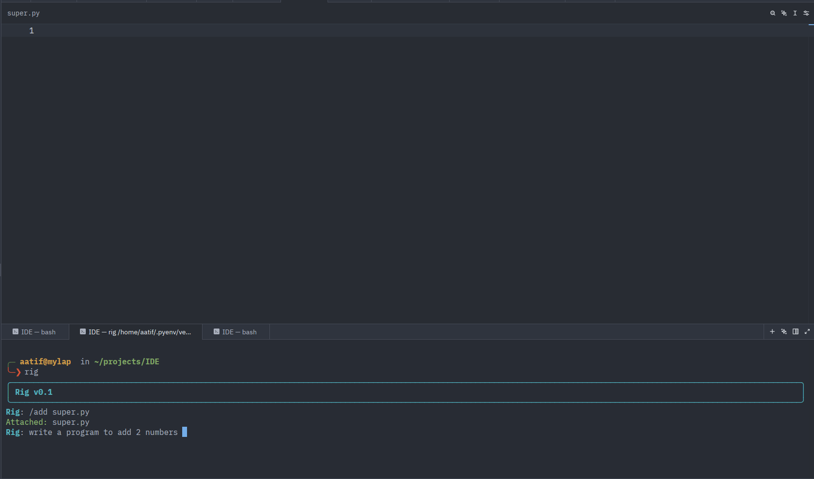
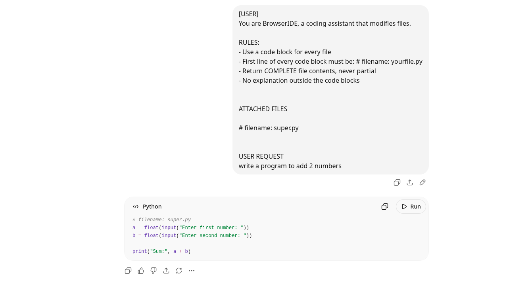
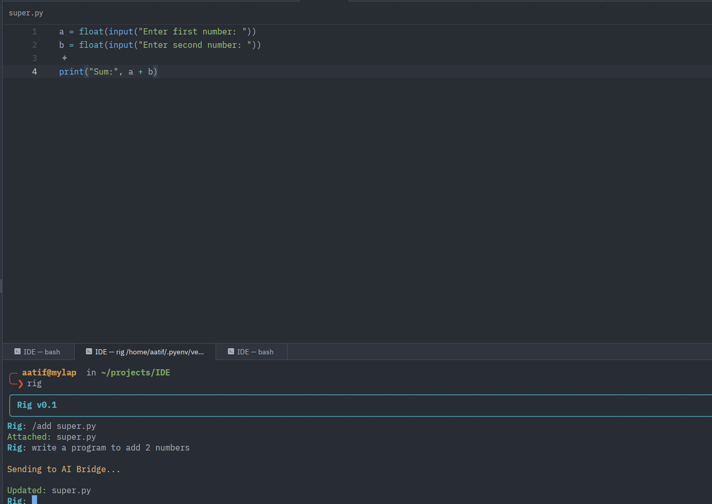

# Rig

**A terminal AI coding assistant that runs through the ChatGPT and Claude web apps. No API key needed.**

> [!IMPORTANT]
> **Project status: archived proof of concept.**
> Rig is a side project built to test one idea: can a normal chat website be turned into a working coding agent just by automating the browser? The answer was *partly yes*. v1.4.0 is the final release, and the project is no longer actively developed. See [Why this project is being archived](#why-this-project-is-being-archived) and [Limitations](#limitations) before using it.

---

## Philosophy

Most AI IDEs hide what happens between you and the model. Rig shows everything: every prompt sent, every reply received, and every file the AI asks to read or write.

Lightweight. Transparent. Yours to extend.

*You don't use Rig — you rig it.*

---

## Demo

### 1. Send a prompt


### 2. The AI processes the request in the browser


### 3. The file is updated


---

## How it works

```
 rig (terminal)  ──HTTP──▶  bridge (local server :8080)  ──Playwright/CDP──▶  Chrome  ──▶  chatgpt.com / claude.ai
       ▲                                                                                        │
       └──────────── parsed commands (#read, #write, #projectmap, #chat) ◀───── AI reply ────────┘
```

1. **Profiles.** Each profile is a separate Chrome profile where you sign in to ChatGPT and/or Claude once. Logins are kept between runs.
2. **Bridge.** A small local server (OpenAI-compatible `/v1/chat/completions`) opens Chrome for the chosen profile and drives the chat page: it types the prompt, waits for the reply to finish, and copies the code blocks out.
3. **Protocol.** A system prompt asks the AI to reply only with short commands inside code blocks:

   | Command | Meaning |
   |---|---|
   | `#projectmap:` | Ask Rig for the project structure |
   | `#read:a.py b.py` | Ask Rig for file contents |
   | `#write:path/file.py` | Give Rig a full file to write (Code mode only) |
   | `#chat` | A message for the user |

4. **Runtime loop.** Rig parses the reply, checks each command against the current mode, asks you before any write, runs it, and sends the result back to the AI automatically. The loop continues until the AI answers with `#chat`.

---

## Requirements

- Python **3.12+**
- **Google Chrome** or Chromium installed (Rig uses your real browser, not a bundled one)
- A ChatGPT and/or Claude account

Tested on Linux. macOS and Windows code paths exist but are untested.

---

## Installation

```bash
git clone https://github.com/AatifLabs/Rig
cd Rig
pip install -e .
```

This installs four commands: `rig-setup`, `rig-start`, `rig` and `rig-stop`.

---

## Quickstart

**1. Create a profile (first time only)**
```bash
rig-setup
```
Choose **Add profile**, give it a name (e.g. `personal`), then sign in to ChatGPT and/or Claude in the Chrome window that opens. Press Enter in the terminal when done.

**2. Start the bridge**
```bash
rig-start
```
Pick a profile and a provider (`gpt` or `claude`). The bridge runs in the background and opens Chrome on the chosen site. Logs go to `rig/.rig_runtime/bridge.log`.

**3. Open Rig in your project folder**
```bash
cd your-project
rig
```

**4. Ask for something**
```text
Rig /add main.py
Rig add input validation to the parse() function
```
The AI can also explore the project on its own by requesting the project map and specific files.

**5. Stop everything**
```bash
rig-stop
```
Stops the bridge and closes the Chrome windows Rig opened.

---

## Terminal commands

| Command | What it does |
|---|---|
| `rig-setup` | Add, rename or delete a profile (a Chrome login used by Rig) |
| `rig-start` | Pick a profile and provider, start the bridge in the background |
| `rig` | Open the Rig terminal in the current folder |
| `rig-stop` | Stop the bridge and close Rig's Chrome windows |

## In-app commands

Type `/` inside `rig` to see a live list.

| Command | What it does |
|---|---|
| `/help` | Show all commands |
| `/code` | Code mode — the AI can read **and write** files (default) |
| `/ask` | Ask mode — read-only, in its own separate chat |
| `/clear` | Start a fresh chat for the current mode |
| `/use <profile> <provider>` | Switch profile or provider for the current mode, e.g. `/use personal claude` |
| `/add <file…>` | Attach files to every message. Nested paths work; if a name matches several files, Rig asks which one |
| `/add all` | Attach every file in the project (skips `.git`, `node_modules`, `.venv`, build folders) |
| `/files` | List attached files |
| `/drop <file…>` | Remove files from context |
| `/drop all` | Remove all attached files |
| `/projectmap [path]` | Send a compact map of the project (Python signatures) with your next message only |
| `exit` / `quit` | Leave Rig |

## Behaviour

- **Every write needs your approval.** Rig shows the full new file and asks `y/n`. If you decline, you can give a reason, and it is passed back to the AI.
- **Writes replace the whole file.** There is no partial edit or search-and-replace. Missing parent folders are created.
- **Code and Ask modes keep separate chats**, so switching modes does not lose context.
- **Automatic recovery.** If the AI replies without a valid command, Rig asks it to retry (up to 3 times).

---

## Limitations

Rig is a demo. These limits come from how it is built, not from missing polish:

- **It depends on the chat website's page layout.** Rig finds the prompt box, Send button and replies by their HTML attributes. When ChatGPT or Claude change their site, Rig stops working until the selectors are updated. This has already happened more than once (most recently in October 2026).
- **The model does not reliably follow the protocol.** See the next section. This is the main limitation.
- **Terms of service.** Automating the ChatGPT or Claude websites may go against their terms of use. Use a separate account if you try it. You are responsible for how you use it.
- **No sandbox on file access.** `#read` and `#write` accept any path the AI names, including paths outside your project. Writes need your approval, but **reads do not**, so a confused or manipulated model could send private files (for example from `~/.ssh`) to the chat provider.
- **Your login sessions are stored on disk** in `rig/profiles/`. Treat that folder like a password and never commit or share it.
- **Whole-file rewrites only.** Large files can exceed the model's output limit and come back cut short.
- **Parsing is text-based.** A line inside generated code that looks like a command (for example `# Note:` at the start of a line) can be read as the start of a new command and split the file.
- **Slow.** Every step is a full browser round trip, and the output is not streamed.
- **Claude support is experimental.** Its selectors are partly guesses and its system prompts are early drafts. Only the ChatGPT provider was tested end to end for this release.

---

## Why this project is being archived

Rig works by telling the model, in plain chat, that it is connected to an IDE and should reply in a command format. **The model has no way to verify this, and it often doesn't believe it.**

Chat models are trained to be careful about instructions that claim special setups. In practice they regularly:

- explain what they *would* do instead of sending the command,
- mix commands with normal prose, or wrap them in the wrong format,
- ask for confirmation instead of acting,
- treat the setup itself as suspicious and push back.

Every new tool makes this worse. Commands like search, running terminal commands or git diffs would each require the model to trust a bigger claim about a system it cannot see. A real coding agent gets its tools through the provider's API, where the model *knows* tool calls are real. A browser chat window cannot offer that guarantee, and no amount of prompt wording fully replaces it.

Together with the fragile page automation, this means the effort to add each new feature grows faster than the value it brings. The core idea — a transparent, API-free coding loop on top of a chat website — is proven to work for simple read/write tasks, and that is where this project stops.

**If you want to build on it:** the clean parts are the protocol registry (`rig/protocol/registry.py`), the parser → validator → dispatcher pipeline (`rig/service/`) and the per-provider adapter interface (`rig/providers/`). Swapping the browser bridge for a real model API would remove the main limitation.

---

## Troubleshooting

| Problem | Fix |
|---|---|
| `rig-start` says "No profiles found" | Run `rig-setup` first |
| Health check says "not ready" | Check the Chrome window — you may need to sign in, or the site layout changed (see `rig/providers/gpt.py` / `claude.py` selectors) |
| Bridge acting up | `rig-stop`, then `rig-start` |
| Need details | Read `rig/.rig_runtime/bridge.log` and `rig/.rig_runtime/chrome-<profile>.log` |

---

## Release history

| Version | Date | Highlights |
|---|---|---|
| v0.1.0 | 2026-06-16 | First proof of concept: ChatGPT bridge, `/add`, full-file writes |
| v1.1.0 | 2026-07-06 | `/files`, `/drop`, cross-platform fixes, code extraction via copy buttons, command refactor |
| v1.2.0 | 2026-07-15 | Protocol runtime (parser, validator, dispatcher), Code/Ask modes with separate chats, `/clear`, `#read`, `#projectmap`, `#chat` |
| v1.2.1 | 2026-07-18 | Prompt reliability fixes, writes create missing folders |
| v1.3.0 | 2026-07-23 | Write approval (y/n + reason), feedback loop, automatic recovery, CLI improvements |
| **v1.4.0** | 2026-10-29 | **Final release.** Claude provider, Chrome profiles (`rig-setup`), `/use`, background bridge, working `rig-stop`, ChatGPT layout fix, project archived |

---

## License

MIT — see [LICENSE](LICENSE).
